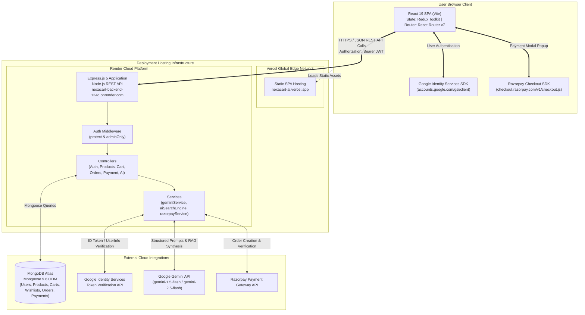
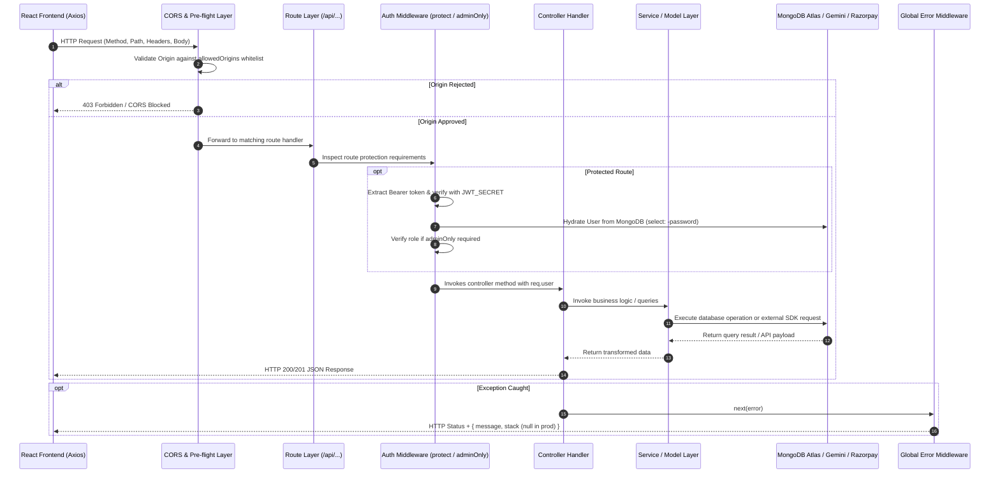
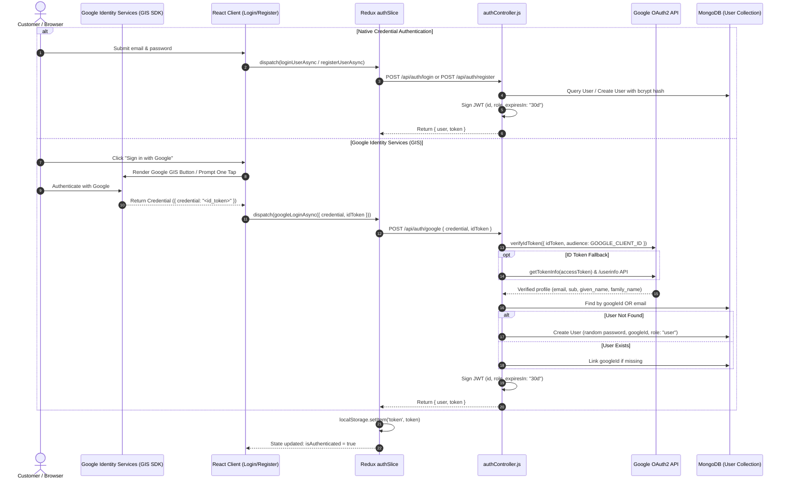
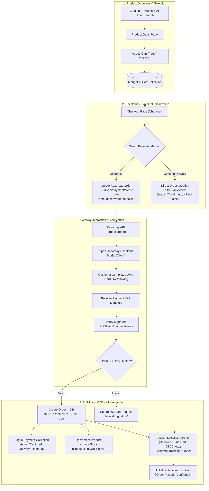
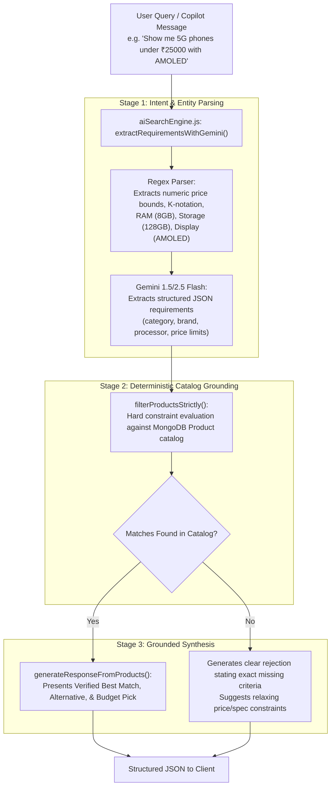
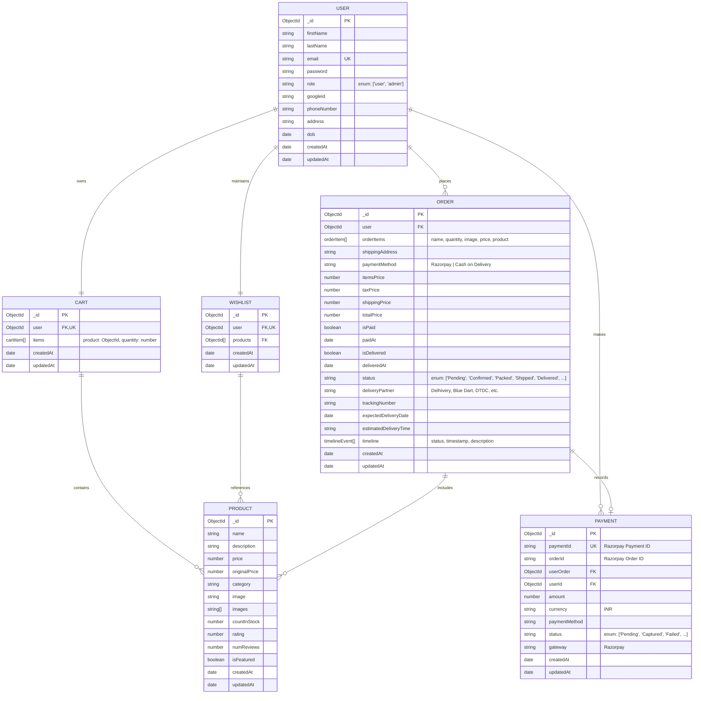
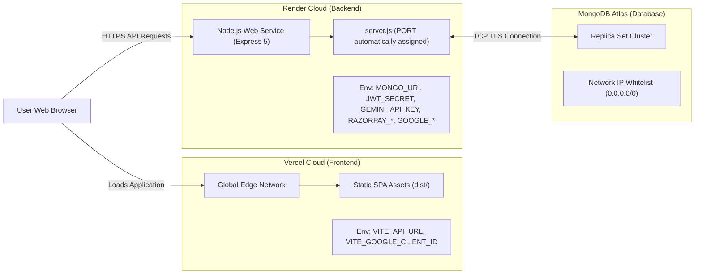

# NexaCart AI — System Architecture & Technical Design

[](#system-overview)
[](#deployment-architecture)
[](#ai-request-pipeline--reasoning-architecture)

---

## Table of Contents

- [System Overview](#system-overview)
- [Technology Architecture](#technology-architecture)
- [High-Level Architecture Diagram](#high-level-architecture-diagram)
- [Repository Structure & Architectural Boundaries](#repository-structure--architectural-boundaries)
- [End-to-End Request Lifecycle](#end-to-end-request-lifecycle)
- [Authentication & Identity Architecture](#authentication--identity-architecture)
- [Shopping, Payment & Fulfillment Lifecycle](#shopping-payment--fulfillment-lifecycle)
- [AI Request Pipeline & Reasoning Architecture](#ai-request-pipeline--reasoning-architecture)
- [Data Model & Schema Relationships](#data-model--schema-relationships)
- [API Topology & Route Organization](#api-topology--route-organization)
- [Deployment Architecture](#deployment-architecture)
- [Security Boundaries & Threat Mitigation](#security-boundaries--threat-mitigation)
- [Operational Resilience & Failure Handling](#operational-resilience--failure-handling)
- [Navigation Links](#navigation-links)

---

## System Overview

**NexaCart AI** is a production-grade, decoupled full-stack eCommerce platform designed around two principal subsystems:

1. **Client-Facing Presentation Tier (Frontend)**: A Single Page Application (SPA) built with React 19, Vite, Tailwind CSS, and Redux Toolkit, deployed to **Vercel**. It offers an interactive catalog, a conversational AI shopping copilot, an automated budget optimizer, a multi-stage checkout with Razorpay and Cash on Delivery, visual order tracking timelines, and an operational admin suite with Recharts data visualization.
2. **Business Logic & Data Tier (Backend)**: An Express 5 REST API running on Node.js and hosted on **Render**. It connects to **MongoDB Atlas** via Mongoose, interfaces with **Google Generative AI (Gemini 1.5/2.5 Flash)** for natural language processing and recommendations, communicates with **Google Identity Services** for OAuth token verification, and integrates with **Razorpay** for payment order creation and cryptographic HMAC-SHA256 signature verification.

The two tiers communicate exclusively via asynchronous JSON-based HTTP requests secured by CORS policies and Bearer JSON Web Tokens.

---

## Technology Architecture

| Architectural Layer | Technologies Employed | Architectural Role |
| :--- | :--- | :--- |
| **Client Application (SPA)** | React 19, Vite 8, Tailwind CSS, Redux Toolkit, React Router v7, Framer Motion, Recharts, React Hot Toast | Renders the responsive UI, manages client state, maintains the conversational shopping chat, and coordinates checkout. |
| **API Application Server** | Node.js (CommonJS), Express.js 5.2, Cookie-Parser, Multer | Routes requests, enforces CORS policies, authenticates JWTs, executes business validation, and orchestrates downstream integrations. |
| **Data Persistence Store** | MongoDB Atlas, Mongoose ODM 9.6 | Stores normalized documents for Users, Products, Carts, Wishlists, Orders, and Payment audit logs with schema constraints. |
| **AI & NLP Engine** | Google Generative AI SDK (`@google/generative-ai`), `gemini-1.5-flash` / `gemini-2.5-flash`, Custom Heuristic Parser | Extracts structured shopping requirements, performs strict database catalog filtering, and synthesizes natural language recommendations. |
| **Identity & Authentication** | Google Auth Library (`OAuth2Client`), JWT (`jsonwebtoken`), Bcryptjs | Dual-path authentication: Google Identity Services (GIS) token verification alongside salted and hashed credentials. |
| **Payment Gateway** | Razorpay Node.js SDK, Razorpay Checkout JS SDK, Node.js Crypto | Generates gateway payment orders, provides the client checkout modal, and verifies HMAC-SHA256 signatures before confirming orders. |
| **Infrastructure & Hosting** | Vercel (Frontend CDN edge network), Render (Backend web service) | Manages build pipelines, zero-downtime rollouts, environment secrets, and HTTPS termination. |

---

## High-Level Architecture Diagram

The diagram below illustrates the architectural boundaries, system relationships, network flows, and external integration touchpoints across NexaCart AI:



---

## Repository Structure & Architectural Boundaries

The codebase is organized into distinct directory boundaries:

```text
nexacart/
├── frontend/                  # Presentation Tier: React + Vite Single Page Application
│   ├── public/                # Static assets served directly
│   ├── src/
│   │   ├── admin/             # Internal admin helper utilities
│   │   ├── ai/                # Client-side AI conversation state, memory bounds, & intent classification
│   │   ├── components/        # Storefront, AI chat (AIChatBox), Admin, & UI primitives
│   │   ├── layouts/           # MainLayout (Storefront) & AdminLayout (Control Center)
│   │   ├── pages/             # Customer route views & 20 specialized Operational Admin views
│   │   ├── redux/             # Redux Toolkit global store and slices (auth, cart, products, etc.)
│   │   ├── services/          # Axios instance (api.js) with dynamic base URL resolution
│   │   └── utils/             # Google GIS loader, invoice generator, and class helpers
│   ├── vite.config.js         # Vite configuration with dev server proxy (/api -> localhost:5000)
│   └── package.json           # Frontend manifests and scripts
│
├── backend/                   # Business Logic & Data Tier: Express REST API
│   ├── config/                # Database connection (db.js) & Catalog auto-seeder (autoSeed.js)
│   ├── controllers/           # HTTP handlers for auth, products, cart, orders, payments, & AI
│   ├── middleware/            # Token verification (protect) & Role authorization (adminOnly)
│   ├── models/                # Mongoose schemas (User, Product, Cart, Wishlist, Order, Payment)
│   ├── routes/                # Express router declarations mapped to route prefixes
│   ├── services/              # Third-party SDK wrappers (Gemini Generative AI, Razorpay)
│   ├── utils/                 # Cryptographic helpers (HMAC-SHA256 signature verification)
│   ├── server.js              # Application entry point, CORS whitelist, & middleware wiring
│   └── package.json           # Backend manifests, dependencies, and execution scripts
│
├── ARCHITECTURE.md            # High-level system architecture and data lifecycle documentation
└── README.md                  # Comprehensive root onboarding and repository entry point
```

---

## End-to-End Request Lifecycle

Every HTTP request dispatched from the React SPA travels through a systematic series of architectural pipeline stages:



---

## Authentication & Identity Architecture

NexaCart AI implements a hybrid authentication mechanism supporting both native credentials and Google OAuth 2.0 (Google Identity Services).



---

## Shopping, Payment & Fulfillment Lifecycle



---

## AI Request Pipeline & Reasoning Architecture

The AI subsystem delivers grounded product recommendations and natural language query extraction using a two-stage hybrid pipeline:



### AI Module Responsibilities

1. **`services/geminiService.js`**:
   - Manages the Google Generative AI client.
   - Defaults to `gemini-1.5-flash`, automatically falling back to `gemini-2.5-flash` if model deprecation or availability issues arise.
   - Provides deterministic local algorithmic fallback functions if `GEMINI_API_KEY` is unavailable or rate-limited.
2. **`services/aiSearchEngine.js`**:
   - Acts as an anti-hallucination guardrail.
   - Evaluates parsed query specifications strictly against actual database documents.
   - Formulates responses citing only verified in-stock products.
3. **`frontend/src/ai/conversationEngine.js`**:
   - Maintains client-side conversation memory across chat turns.
   - Retains active price bounds and specifications while allowing users to refine filters iteratively.

---

## Data Model & Schema Relationships

The database layer consists of six Mongoose models in [`backend/models/`](backend/models/):



---

## API Topology & Route Organization

All API endpoints reside beneath the `/api` route prefix. The table below maps prefixes, route files, and controllers:

| Route Prefix | Router File | Controller File | Purpose |
| :--- | :--- | :--- | :--- |
| `/api/auth` | [`routes/authRoutes.js`](backend/routes/authRoutes.js) | [`controllers/authController.js`](backend/controllers/authController.js) | Registration, login, profile management, Google OAuth token verification. |
| `/api/products` | [`routes/productRoutes.js`](backend/routes/productRoutes.js) | [`controllers/productController.js`](backend/controllers/productController.js) | Public catalog queries, regex keyword search, category and price filters. |
| `/api/cart` | [`routes/cartRoutes.js`](backend/routes/cartRoutes.js) | [`controllers/cartController.js`](backend/controllers/cartController.js) | Authenticated cart CRUD, item quantity increment/decrement, cart clearing. |
| `/api/wishlist` | [`routes/wishlistRoutes.js`](backend/routes/wishlistRoutes.js) | [`controllers/wishlistController.js`](backend/controllers/wishlistController.js) | Authenticated wishlist retrieval, additions, and removals. |
| `/api/orders` | [`routes/orderRoutes.js`](backend/routes/orderRoutes.js) | [`controllers/orderController.js`](backend/controllers/orderController.js) | Order creation, personal order history, order cancellation, return requests, admin status updates. |
| `/api/payment` | [`routes/paymentRoutes.js`](backend/routes/paymentRoutes.js) | [`controllers/paymentController.js`](backend/controllers/paymentController.js) | Razorpay order generation, HMAC-SHA256 signature verification, admin payment audit ledger. |
| `/api/ai` | [`routes/aiRoutes.js`](backend/routes/aiRoutes.js) | [`controllers/aiController.js`](backend/controllers/aiController.js)<br/>[`controllers/geminiController.js`](backend/controllers/geminiController.js) | AI smart search, personalized recommendations, budget assistant, diagnostic tests. |

---

## Deployment Architecture



### Communication & Configuration
- **Frontend Hosting**: Deployed to Vercel at `https://nexacart-ai.vercel.app`. Built from the `frontend/` directory with `vite build`.
- **Backend Hosting**: Deployed to Render as an automated Web Service at `https://nexacart-backend-124q.onrender.com`. Executed via `npm start` (`node server.js`).
- **Dynamic Port Assignment**: Render assigns dynamic ports via `process.env.PORT`, handled by Express in [`server.js`](backend/server.js#L101-L103).
- **CORS Configuration**: [`server.js`](backend/server.js#L23-L58) whitelists local ports, `https://nexacart-ai.vercel.app`, and Vercel branch previews (`https://nexacart-*.vercel.app`).

---

## Security Boundaries & Threat Mitigation

1. **Password Encryption**: Passwords are salted (10 rounds) and hashed using `bcryptjs` in a Mongoose pre-save hook before persisting to MongoDB. Plaintext passwords are never stored or logged.
2. **Stateless JWT Authorization**: Sensitive routes require a JSON Web Token signed with `JWT_SECRET`. Tokens expire after 30 days. Password hashes are excluded from hydrated user objects (`select('-password')`).
3. **Role-Based Access Control (RBAC)**: Distinct authorization checks differentiate regular shoppers (`role: 'user'`) from administrators (`role: 'admin'`). Administrative endpoints (`/api/orders/admin/all`, `/api/payment/admin/all`, status update endpoints) enforce `adminOnly` middleware.
4. **Payment Integrity**: Razorpay payments are confirmed exclusively after server-side cryptographic HMAC-SHA256 signature verification matching `razorpay_order_id` and `razorpay_payment_id` against `RAZORPAY_KEY_SECRET`. Client-supplied payment outcomes are never trusted without cryptographic proof.
5. **CORS Origin Whitelisting**: Strict origin matching prevents unauthorized third-party websites from making authenticated requests on behalf of users.
6. **NoSQL Injection Defense**: MongoDB queries are formulated using Mongoose schema object parameters, preventing unescaped query-injection attacks.

---

## Operational Resilience & Failure Handling

### Existing Implementation Behaviors

| Subsystem | Existing Error Handling & Resilience Strategy |
| :--- | :--- |
| **Google Gemini API** | Multi-tier failover: (1) Attempts primary query with `gemini-1.5-flash`; (2) If unavailable, automatically falls back to `gemini-2.5-flash`; (3) If offline, quota-exceeded (HTTP 429), or missing API key, switches to deterministic local catalog heuristics without crashing. |
| **Razorpay Payments** | If credentials are placeholder strings or API keys are unregistered, the backend detects the condition, logs a warning, and generates a simulated test order ID (`order_test_<timestamp>`), enabling local verification without a live merchant account. |
| **Catalog Seeding** | On server boot, `server.js` verifies product catalog volume. If the catalog contains fewer than 500 items, it automatically seeds 595+ sample items. If 500 or more items are present, seeding is safely bypassed. |
| **Express Middleware** | Global uncaught exception middleware intercepts unhandled errors, returning structured JSON error messages while omitting stack traces in production (`process.env.NODE_ENV === 'production'`). |
| **Admin UI Modules** | All administrative routes are wrapped inside an isolated React Error Boundary (`AdminErrorBoundary.jsx`), preventing a failure in an individual analytics component from crashing the wider application. |

### Recommended Future Improvements (Not Currently Implemented)
*These items represent architectural roadmap recommendations, not existing capabilities:*
- **Automated Test Suite**: Implementing integration test suites (e.g., Jest/Supertest for backend, Vitest/React Testing Library for frontend) to replace the current placeholder test script.
- **Distributed Caching**: Introducing Redis for frequently queried product listings and category aggregations.
- **Refresh Token Rotation**: Migrating from long-lived 30-day JWTs to short-lived access tokens paired with secure HTTP-only refresh token cookies.
- **Razorpay Webhooks**: Implementing an asynchronous webhook listener (`/api/payment/webhook`) to handle payment events even if a customer closes their browser prior to redirect.
- **Rate Limiting**: Introducing `express-rate-limit` to throttle brute-force login attempts and AI endpoint abuse.

---

## Navigation Links

- **Root Documentation**: [README.md](README.md)
- **Frontend Documentation**: [frontend/README.md](frontend/README.md)
- **Backend Documentation**: [backend/README.md](backend/README.md)
