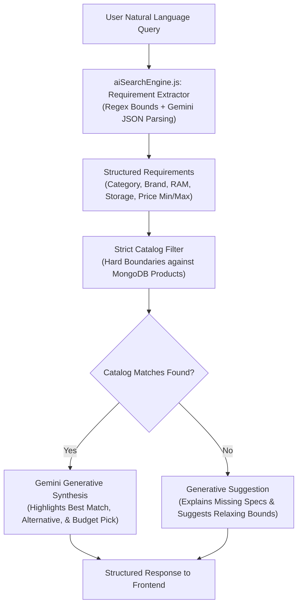
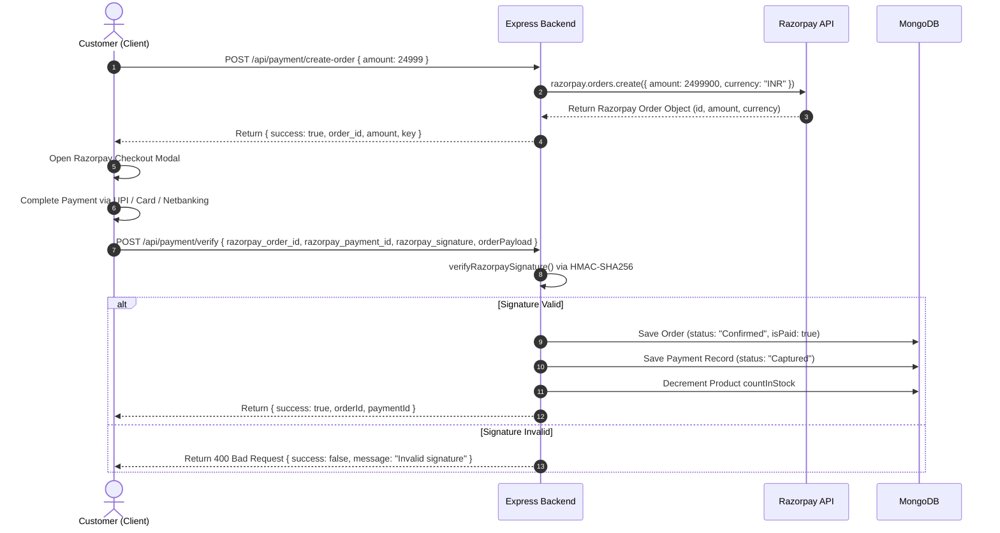

# NexaCart AI — Backend Service

[](https://nodejs.org/)
[](https://expressjs.com/)
[](https://www.mongodb.com/)
[](https://ai.google.dev/)
[](https://razorpay.com/)

The **NexaCart AI Backend** is an enterprise-ready Express.js REST application engineered with Node.js, MongoDB Atlas (via Mongoose), Google Generative AI (Gemini), Google OAuth 2.0 Identity Services, and Razorpay payment integration. It powers user authentication, product catalog operations, cart and wishlist persistence, multi-phase order lifecycle workflows, administrative analytics, and strict AI-driven shopping assistance.

---

## Table of Contents

- [Architectural Overview](#architectural-overview)
- [Folder Structure](#folder-structure)
- [Prerequisites](#prerequisites)
- [Installation & Local Setup](#installation--local-setup)
- [Available Package Scripts](#available-package-scripts)
- [Environment Configuration](#environment-configuration)
- [Database Management & Auto-Seeding](#database-management--auto-seeding)
- [Authentication & Authorization](#authentication--authorization)
- [AI Engine Architecture (Gemini & NLP)](#ai-engine-architecture-gemini--nlp)
- [Payment Integration (Razorpay)](#payment-integration-razorpay)
- [Order Fulfillment & Logistics Tracking](#order-fulfillment--logistics-tracking)
- [CORS Configuration & Security](#cors-configuration--security)
- [REST API Reference](#rest-api-reference)
  - [Authentication (`/api/auth`)](#authentication-apiauth)
  - [Products (`/api/products`)](#products-apiproducts)
  - [Cart (`/api/cart`)](#cart-apicart)
  - [Wishlist (`/api/wishlist`)](#wishlist-apiwishlist)
  - [Orders (`/api/orders`)](#orders-apiorders)
  - [Payments (`/api/payment`)](#payments-apipayment)
  - [AI Shopping & Search (`/api/ai`)](#ai-shopping--search-apiai)
- [Deployment on Render](#deployment-on-render)
- [Troubleshooting & Diagnostics](#troubleshooting--diagnostics)
- [Navigation Links](#navigation-links)

---

## Architectural Overview

The backend follows an MVC-inspired layered design pattern separating HTTP routing, controller orchestration, business service logic, and database modeling:

1. **Routing Layer (`/routes`)**: Maps URI endpoints to controllers and applies route-level authentication/authorization middleware.
2. **Controller Layer (`/controllers`)**: Validates request parameters, coordinates database queries via models, handles business logic, and shapes structured JSON responses.
3. **Data Access Layer (`/models`)**: Defines Mongoose schemas with type casting, required fields, relational references, indexes, and document middleware.
4. **Services Layer (`/services`)**: Encapsulates external third-party SDK clients, including Google Gemini Generative AI and Razorpay order management, with built-in fallbacks.
5. **Utilities Layer (`/utils`)**: Provides specialized crypto helpers, including HMAC-SHA256 signature verification for online payments.
6. **Middleware Layer (`/middleware`)**: Handles JWT parsing, user hydration, role-based access validation, and centralized error forwarding.

---

## Folder Structure

```text
backend/
├── config/
│   ├── autoSeed.js            # 595+ sample catalog items automatically seeded on boot
│   └── db.js                  # MongoDB Atlas connection handler using Mongoose
├── controllers/
│   ├── aiController.js        # Authenticated AI recommendations, smart search, & budget copilot
│   ├── authController.js      # Register, login, profile updates, and Google GIS token authentication
│   ├── cartController.js      # Cart CRUD, item quantity updates, and cart clearing
│   ├── geminiController.js    # Publicly testable endpoints for Gemini AI queries
│   ├── orderController.js     # Order placement, status tracking, cancellation, & return requests
│   ├── paymentController.js   # Razorpay order generation, signature verification, & admin payment ledger
│   ├── productController.js   # Product querying with regex search and category/price filters
│   └── wishlistController.js  # User wishlist toggle and synchronization
├── middleware/
│   └── authMiddleware.js      # JWT token extraction ('protect') & role validation ('adminOnly')
├── models/
│   ├── Cart.js                # User cart schema with referenced Product sub-documents
│   ├── Order.js               # Order schema with timeline, delivery partner, tracking, and statuses
│   ├── Payment.js             # Detailed audit log for payment transactions and gateways
│   ├── Product.js             # Product catalog schema (pricing, inventory, multi-image galleries)
│   ├── User.js                # User schema with bcrypt password hashing and roles ('user' | 'admin')
│   └── Wishlist.js            # User wishlist schema referencing products
├── routes/
│   ├── aiRoutes.js            # Routes mounted at /api/ai
│   ├── authRoutes.js          # Routes mounted at /api/auth
│   ├── cartRoutes.js          # Routes mounted at /api/cart
│   ├── orderRoutes.js         # Routes mounted at /api/orders
│   ├── paymentRoutes.js       # Routes mounted at /api/payment, /api/payments, and /payment
│   ├── productRoutes.js       # Routes mounted at /api/products
│   └── wishlistRoutes.js      # Routes mounted at /api/wishlist
├── services/
│   ├── aiSearchEngine.js      # Hybrid regex + Gemini requirement extractor with strict catalog filtering
│   ├── geminiService.js       # Gemini 1.5/2.5 Flash client with fallback heuristics
│   └── razorpayService.js     # Razorpay SDK initialization and order creation
├── utils/
│   └── paymentVerification.js # HMAC-SHA256 payment signature verification
├── .env                       # Local environment variables (do not commit to Git)
├── buildFullCatalog.js        # Standalone catalog builder script used to compile autoSeed.js
├── package.json               # Backend dependencies and scripts
├── package-lock.json          # Deterministic dependency lockfile
├── seeder.js                  # Manual CLI script to wipe and re-seed the product catalog
├── server.js                  # Express application entry point, CORS, middleware, & port listener
└── testGemini.js              # Standalone CLI test utility for validating Gemini API credentials
```

---

## Prerequisites

- **Node.js**: v18.x or v20.x LTS (compatible with CommonJS runtime)
- **npm**: v9.x or v10.x
- **MongoDB**: Active MongoDB Atlas cluster or local MongoDB instance (v5.0+)
- **Google Cloud Console**: OAuth 2.0 Web Client ID & Client Secret
- **Google AI Studio**: Gemini API key
- **Razorpay Dashboard**: Test Mode Key ID & Key Secret (optional fallback supported)

---

## Installation & Local Setup

1. **Navigate to the backend directory**:
   ```bash
   cd backend
   ```

2. **Install project dependencies**:
   ```bash
   npm install
   ```

3. **Configure environment variables**:
   Create a `.env` file in the `backend/` directory:
   ```bash
   cp .env.example .env
   # Or create backend/.env manually using the variable template below
   ```

4. **Verify external integrations (Optional)**:
   Test Gemini API connectivity using the built-in diagnostic script:
   ```bash
   node testGemini.js
   ```

5. **Start the backend server**:
   - For active development with hot-reloading:
     ```bash
     npm run dev
     ```
   - For standard production execution:
     ```bash
     npm start
     ```

The server binds to `http://localhost:5000` (or your configured `PORT`) and verifies MongoDB connectivity upon startup.

---

## Available Package Scripts

These scripts are defined in [`backend/package.json`](package.json):

| Script | Command | Purpose |
| :--- | :--- | :--- |
| `start` | `node server.js` | Starts the production Express server. |
| `dev` | `nodemon server.js` | Starts the server with `nodemon` for automatic reloading on code changes. |
| `data:seed` | `node seeder.js` | Clears all existing products in MongoDB and populates the 595+ item catalog. |
| `test` | `echo "Error: no test specified" && exit 1` | **Placeholder script**. An automated test suite is not currently implemented in this repository. Executing this command will deliberately exit with error code 1. |

---

## Environment Configuration

Create a `.env` file inside the `backend/` directory. All environment variables verified from the source code are documented below:

```ini
# Server Configuration
PORT=5000
NODE_ENV=development

# Database Connection
MONGO_URI=mongodb+srv://<username>:<password>@cluster0.mongodb.net/nexacart?retryWrites=true&w=majority

# JWT Token Secret
JWT_SECRET=your_jwt_secret_key_change_in_production

# Google Gemini API
GEMINI_API_KEY=your_gemini_api_key

# Google OAuth 2.0 Credentials (for GIS Token Verification)
GOOGLE_CLIENT_ID=your_google_client_id.apps.googleusercontent.com
GOOGLE_CLIENT_SECRET=your_google_client_secret

# Razorpay Payment Gateway
RAZORPAY_KEY_ID=rzp_test_your_razorpay_key_id
RAZORPAY_KEY_SECRET=your_razorpay_key_secret

# Merchant UPI Metadata (Optional)
UPI_ID=nexacart@upi
UPI_MERCHANT_NAME=NexaCart AI

# Allowed Client Origin (Optional CORS override)
CLIENT_URL=https://nexacart-ai.vercel.app
```

### Environment Variable Reference

| Variable | Required | Description |
| :--- | :---: | :--- |
| `PORT` | No | Server listener port (defaults to `5000`). Automatically set by platforms like Render. |
| `NODE_ENV` | No | Execution environment (`development` or `production`). In production, stack traces are omitted from 500 error responses. |
| `MONGO_URI` | **Yes** | MongoDB connection string. Must point to a valid MongoDB database. |
| `JWT_SECRET` | **Yes** | Secret string used to sign and verify JSON Web Tokens. Fallback to `JWT_SECRET_KEY` or a default string occurs if omitted, but setting an explicit secret is strongly required. |
| `GEMINI_API_KEY` | **Yes** | Google Generative AI API key used by `geminiService.js` and `aiSearchEngine.js`. When missing or invalid, local fallback algorithms execute. |
| `GOOGLE_CLIENT_ID` | **Yes** | Client ID for Google Identity Services. Used to verify Google ID tokens via `google-auth-library`. |
| `GOOGLE_CLIENT_SECRET` | **Yes** | Client Secret for Google OAuth. Can also be named `GOOGLE_SECRET_ID`. |
| `RAZORPAY_KEY_ID` | **Yes** | Razorpay Key ID used for order generation. If missing or invalid, the backend emits a warning and returns simulated test orders. |
| `RAZORPAY_KEY_SECRET` | **Yes** | Razorpay Key Secret used in HMAC-SHA256 signature verification. |
| `CLIENT_URL` | No | Additional frontend URL allowed through CORS (e.g. production domain). |
| `UPI_ID` | No | Merchant UPI identifier for UPI transactions (defaults to `nexacart@upi`). |
| `UPI_MERCHANT_NAME` | No | Merchant name displayed in UPI transaction descriptions. |

---

## Database Management & Auto-Seeding

### Automatic Seeding on Startup
When the Express server establishes a connection to MongoDB in [`server.js`](server.js#L12-L15), it invokes [`config/autoSeed.js`](config/autoSeed.js):
- Checks total documents in the `Product` collection (`Product.countDocuments()`).
- If fewer than 500 products exist, it clears the collection and automatically imports **595+ curated, categorized items** across Mobiles, Laptops, Electronics, Gaming, Groceries, Fashion, Furniture, Home & Office, Kitchen, and Books.
- If 500 or more products are already present, seeding is safely skipped.

### Manual Database Reset
To force a catalog reset at any time:
```bash
npm run data:seed
```
This runs [`seeder.js`](seeder.js), connecting directly to `MONGO_URI`, dropping all products via `Product.deleteMany({})`, and re-running `autoSeed()`.

---

## Authentication & Authorization

Authentication is handled through stateless JSON Web Tokens (JWT) stored client-side in `localStorage` and passed in the `Authorization` header.

### 1. Traditional Email/Password
- **Registration (`POST /api/auth/register`)**: Validates email uniqueness, formats names and phone numbers, hashes passwords with `bcryptjs` (10 salt rounds via Mongoose pre-save hook), and issues a signed JWT valid for 30 days.
- **Login (`POST /api/auth/login`)**: Finds user by email, executes `user.matchPassword(password)`, and returns user profile data along with the JWT.

### 2. Google OAuth 2.0 (Google Identity Services GIS)
- Endpoint: `POST /api/auth/google`
- Accepts `{ idToken, credential, accessToken }` from the frontend.
- **Verification Strategy**:
  1. Inspects `idToken` or `credential` using `googleClient.verifyIdToken({ idToken, audience: GOOGLE_CLIENT_ID })`.
  2. If the ID token does not resolve an email, inspects `accessToken` using `googleClient.getTokenInfo(accessToken)` and queries `https://www.googleapis.com/oauth2/v3/userinfo`.
  3. Looks up existing user by `googleId` or `email`.
  4. If user does not exist, creates a new account with a securely generated random password.
  5. If user exists with matching email but missing `googleId`, associates the Google identity.
  6. Returns authenticated user payload with a signed JWT.

### 3. Middleware Authorization
- **`protect`** ([`middleware/authMiddleware.js`](middleware/authMiddleware.js#L4-L35)): Extracts the token from `Authorization: Bearer <token>`, verifies the signature with `JWT_SECRET`, and populates `req.user` (excluding password field).
- **`adminOnly`** ([`middleware/authMiddleware.js`](middleware/authMiddleware.js#L37-L43)): Validates that `req.user.role === 'admin'`. Unauthorized users receive a `403 Forbidden` response.

---

## AI Engine Architecture (Gemini & NLP)

NexaCart AI integrates Google Generative AI (`@google/generative-ai`) paired with a deterministic catalog verification layer in [`services/aiSearchEngine.js`](services/aiSearchEngine.js) and [`services/geminiService.js`](services/geminiService.js).



### Core AI Capabilities
1. **Model Fallback**:
   The service initiates requests targeting `gemini-1.5-flash`. If Google returns a `404 Not Found` or deprecation error, the service automatically pivots to `gemini-2.5-flash`.
2. **Strict Catalog Grounding**:
   Unlike generic conversational bots that invent fictional products, `aiSearchEngine.js` strictly filters actual MongoDB documents. Generative responses only present verified items present in the database.
3. **Smart Search (`POST /api/ai/search` and `GET /api/ai/smart-search`)**:
   Extracts price bounds (e.g. *"between 500 and 700"*, *"under 30000"*), brands, technical specs (RAM, Storage, AMOLED display, Processor), and returns ordered products with reasoning.
4. **Personalized Recommendations (`POST /api/ai/recommendations` and `GET /api/ai/recommendations`)**:
   Analyzes customer interest categories from active cart and wishlist items, feeding profile data to Gemini to recommend complementary items while filtering out items already added.
5. **Smart Budget Assistant (`POST /api/ai/budget` and `POST /api/ai/budget-assistant`)**:
   Takes a monetary limit and desired category, computes combinations of products that maximize value under the cap, calculates instant discount savings vs. original retail prices, checks the free shipping qualification threshold (₹1,500), and offers cost-saving swap alternatives.
6. **Local Fallback Heuristics**:
   If `GEMINI_API_KEY` is unconfigured, rate-limited (HTTP 429), or unavailable, the backend seamlessly switches to deterministic local algorithmic matching (highest rating, category relevance, and knapsack price optimization) without throwing fatal errors.

---

## Payment Integration (Razorpay)

Payment handling is implemented in [`controllers/paymentController.js`](controllers/paymentController.js), [`services/razorpayService.js`](services/razorpayService.js), and [`utils/paymentVerification.js`](utils/paymentVerification.js).

### Payment Lifecycle



### Signature Verification Algorithm
```javascript
const crypto = require('crypto');
const generatedSignature = crypto
  .createHmac('sha256', process.env.RAZORPAY_KEY_SECRET)
  .update(`${razorpay_order_id}|${razorpay_payment_id}`)
  .digest('hex');
const isValid = (generatedSignature === razorpay_signature);
```

### Local Test Mode Fallback
If placeholder keys (such as `rzp_test_TLclhAg6ygDSCS` or strings containing `NexaCartKeyId`) are used without live Razorpay connectivity, `razorpayService.js` creates a simulated test order (`order_test_<timestamp>`), allowing complete checkout flows without runtime disruption.

---

## Order Fulfillment & Logistics Tracking

Orders created in [`models/Order.js`](models/Order.js) feature a full logistics lifecycle:
- **Couriers Supported**: Automatic random assignment across prominent Indian carriers (`Delhivery`, `Blue Dart`, `DTDC`, `XpressBees`, `Ekart`, `India Post`).
- **Tracking Number Generation**: Generates compliant tracking numbers formatted with carrier prefixes and domestic suffixes (e.g., `DEL829103847IN`).
- **Order Statuses**:
  `Pending` → `Waiting for Payment` → `Payment Submitted` → `Admin Verified` → `Confirmed` → `Processing` → `Packed` → `Ready for Shipment` → `Shipped` → `In Transit` → `Out for Delivery` → `Delivered` → `Cancelled` → `Returned` → `Refunded` → `Payment Rejected`.
- **Order Timeline**: Every status update appends an event to the `timeline` array containing status, timestamp, and descriptive context.
- **Inventory Synchronization**: When an order is confirmed, `countInStock` for each item is automatically decremented. If an eligible order (`Pending`, `Confirmed`, `Packed`) is cancelled via `PUT /api/orders/:id/cancel`, stock counts are restored.

---

## CORS Configuration & Security

The CORS configuration in [`server.js`](server.js#L22-L58) protects endpoints while enabling modern development and deployment workflows:

### Whitelisted Origins
- Local Development:
  - `http://localhost:5173` & `http://localhost:5174`
  - `http://127.0.0.1:5173` & `http://127.0.0.1:5174`
  - Dynamic regex for any local port: `/^http:\/\/localhost:\d+$/` and `/^http:\/\/127\.0\.0\.1:\d+$/`
- Production Domains:
  - `https://nexacart-ai.vercel.app`
  - Dynamic regex for Vercel preview environments: `/^https:\/\/nexacart-.*\.vercel\.app$/`
  - Custom environment URL provided via `CLIENT_URL`.
- Non-browser requests (Postman, cURL, server-to-server) without an `Origin` header are permitted.

### Security Headers & Options
- `credentials: true` (allows authenticated cross-origin requests with cookies and authorization headers).
- Allowed Methods: `GET`, `POST`, `PUT`, `DELETE`, `OPTIONS`, `PATCH`.
- Allowed Headers: `Content-Type`, `Authorization`, `X-Requested-With`.

---

## REST API Reference

All routes are prefixed with `/api`. Authenticated endpoints require `Authorization: Bearer <token>`.

### Authentication (`/api/auth`)

| Method | Endpoint | Access | Description |
| :--- | :--- | :---: | :--- |
| `POST` | `/api/auth/register` | Public | Register a new user account and receive a JWT. |
| `POST` | `/api/auth/login` | Public | Authenticate with email/password and receive a JWT. |
| `POST` | `/api/auth/google` | Public | Verify Google OAuth token (`idToken`, `credential`, or `accessToken`) and return user with JWT. |
| `GET` | `/api/auth/profile` | Protected | Retrieve authenticated user's profile details. |
| `PUT` | `/api/auth/profile` | Protected | Update profile details (name, phone, address, password). |

#### Example: Register User
```bash
POST /api/auth/register
Content-Type: application/json

{
  "firstName": "John",
  "lastName": "Doe",
  "email": "john.doe@example.com",
  "password": "Password123!",
  "phoneNumber": "+919876543210",
  "address": "42 Market Street, Bangalore"
}
```
**Response (`201 Created`)**:
```json
{
  "user": {
    "_id": "673f1234567890abcdef1234",
    "firstName": "John",
    "lastName": "Doe",
    "email": "john.doe@example.com",
    "phoneNumber": "+919876543210",
    "address": "42 Market Street, Bangalore",
    "role": "user"
  },
  "token": "eyJhbGciOiJIUzI1NiIsInR5cCI6IkpXVCJ9..."
}
```

---

### Products (`/api/products`)

| Method | Endpoint | Access | Query Parameters | Description |
| :--- | :--- | :---: | :--- | :--- |
| `GET` | `/api/products` | Public | `category`, `search`, `minPrice`, `maxPrice` | Query product catalog with regex name/description matching and price boundaries. |
| `GET` | `/api/products/:id` | Public | None | Retrieve complete details for a single product by MongoDB ID. |

#### Example: Filter Products
```bash
GET /api/products?category=Mobiles&minPrice=15000&maxPrice=30000
```
**Response (`200 OK`)**:
```json
[
  {
    "_id": "673f9876543210abcdef5678",
    "name": "Realme 12 Pro+ 5G (8GB RAM, 256GB Storage)",
    "price": 24999,
    "originalPrice": 29999,
    "category": "Mobiles",
    "countInStock": 25,
    "rating": 4.6,
    "numReviews": 180,
    "isFeatured": true,
    "description": "Brand: Realme | RAM: 8GB | Storage: 256GB...",
    "image": "https://images.unsplash.com/...",
    "images": ["https://images.unsplash.com/..."]
  }
]
```

---

### Cart (`/api/cart`)

All cart routes require authentication (`protect`).

| Method | Endpoint | Access | Description |
| :--- | :--- | :---: | :--- |
| `GET` | `/api/cart` | Protected | Retrieve the authenticated user's cart populated with product details. |
| `POST` | `/api/cart` | Protected | Add an item to the cart (`{ productId, quantity }`). |
| `PUT` | `/api/cart` | Protected | Update item quantity in the cart (`{ productId, quantity }`). |
| `DELETE` | `/api/cart/:productId` | Protected | Remove a specific product from the cart. |
| `POST` | `/api/cart/clear` | Protected | Empty the entire cart. |

---

### Wishlist (`/api/wishlist`)

All wishlist routes require authentication (`protect`).

| Method | Endpoint | Access | Description |
| :--- | :--- | :---: | :--- |
| `GET` | `/api/wishlist` | Protected | Retrieve user's wishlist populated with product objects. |
| `POST` | `/api/wishlist` | Protected | Add product to wishlist (`{ productId }`). |
| `DELETE` | `/api/wishlist/:productId` | Protected | Remove product from wishlist. |

---

### Orders (`/api/orders`)

All order routes require authentication (`protect`).

| Method | Endpoint | Access | Description |
| :--- | :--- | :---: | :--- |
| `POST` | `/api/orders` | Protected | Create a new order (used for Direct / Cash on Delivery checkout). |
| `GET` | `/api/orders` | Protected | Retrieve all orders placed by the authenticated user. |
| `GET` | `/api/orders/:id` | Protected | Retrieve full details of an order (Customer can access own order; Admins can access any). |
| `PUT` | `/api/orders/:id/cancel` | Protected | Cancel an order before shipment (`Pending`, `Confirmed`, `Packed`) and restore inventory. |
| `PUT` | `/api/orders/:id/return` | Protected | Request return/refund for an order in `Delivered` status. |
| `GET` | `/api/orders/admin/all` | Admin Only | Administrative overview of all orders across the entire customer base. |
| `PUT` | `/api/orders/:id/admin-status` | Admin Only | Update order status, assigned courier partner, and tracking ID. |

---

### Payments (`/api/payment`)

*Note: Aliased also under `/api/payments` and `/payment`.*

| Method | Endpoint | Access | Description |
| :--- | :--- | :---: | :--- |
| `POST` | `/api/payment/create-order` | Protected | Initialize a Razorpay order with amount in INR; returns order ID and key. |
| `POST` | `/api/payment/verify` | Protected | Verify Razorpay HMAC-SHA256 signature, confirm order in DB, and reduce stock. |
| `GET` | `/api/payment/order/:orderId` | Protected | Retrieve payment audit record for a given user order ID. |
| `GET` | `/api/payment/admin/all` | Admin Only | Retrieve all payment audit logs with populated user and order records. |
| `POST` | `/api/payment/admin/verify-payment` | Admin Only | Administrative manual verification of payment transactions. |

#### Example: Verify Payment Signature
```bash
POST /api/payment/verify
Authorization: Bearer <jwt_token>
Content-Type: application/json

{
  "razorpay_order_id": "order_OG92jKlM93N21a",
  "razorpay_payment_id": "pay_OG92xZkL10B49c",
  "razorpay_signature": "4a7f053e18a9947702812bb1478294bc1723b3f2e1a4998ef2e2df5846f4142a",
  "orderPayload": {
    "orderItems": [
      {
        "product": "673f9876543210abcdef5678",
        "name": "Realme 12 Pro+ 5G",
        "quantity": 1,
        "price": 24999,
        "image": "https://images.unsplash.com/..."
      }
    ],
    "shippingAddress": "42 Market Street, Bangalore",
    "paymentMethod": "Razorpay",
    "totalPrice": 24999
  }
}
```

---

### AI Shopping & Search (`/api/ai`)

| Method | Endpoint | Access | Description |
| :--- | :--- | :---: | :--- |
| `POST` | `/api/ai/test` | Public | Diagnostic endpoint executing a predefined Gemini prompt. |
| `POST` | `/api/ai/search` | Public | Public Smart Search endpoint accepting `{ query: "..." }`. |
| `POST` | `/api/ai/recommendations` | Public | Public recommendation query with category and product IDs. |
| `POST` | `/api/ai/budget` | Public | Public budget optimizer accepting `{ budget: 50000, category: "Laptops" }`. |
| `GET` | `/api/ai/recommendations` | Protected | Personalized recommendations tailored to user's cart and wishlist history. |
| `POST` | `/api/ai/budget-assistant` | Protected | Authenticated budget assistant computing instant savings, shipping tips, and alternatives. |
| `GET` | `/api/ai/smart-search` | Protected | Query parameter natural language search (`?q=phone under 20000`). |

---

## Deployment on Render

The backend is configured for deployment as a **Web Service** on [Render](https://render.com/).

### Deployment Settings
- **Environment**: `Node`
- **Root Directory**: `backend`
- **Build Command**:
  ```bash
  npm install
  ```
- **Start Command**:
  ```bash
  npm start
  ```

### Required Render Environment Variables
Configure these in the Render dashboard under **Environment**:
1. `NODE_ENV`: `production`
2. `PORT`: `10000` (or leave default; Render automatically populates `PORT`)
3. `MONGO_URI`: Production MongoDB Atlas connection URI
4. `JWT_SECRET`: Production random cryptographic secret
5. `GEMINI_API_KEY`: Production Google AI Studio API key
6. `GOOGLE_CLIENT_ID`: Production Google Cloud OAuth 2.0 Web Client ID
7. `GOOGLE_CLIENT_SECRET`: Production Google Cloud OAuth Client Secret
8. `RAZORPAY_KEY_ID`: Production or Test Razorpay Key ID
9. `RAZORPAY_KEY_SECRET`: Production or Test Razorpay Key Secret
10. `CLIENT_URL`: `https://nexacart-ai.vercel.app` (your frontend production domain)

---

## Troubleshooting & Diagnostics

### 1. MongoDB Connection Timeouts or Failures
- **Symptom**: `Error: connect ECONNREFUSED` or server crashes during `connectDB()`.
- **Cause**: IP address not whitelisted in MongoDB Atlas or invalid credentials in `MONGO_URI`.
- **Fix**: Open MongoDB Atlas → **Network Access** → Add `0.0.0.0/0` (allow access from anywhere) or specific Render IP ranges. Confirm database user credentials.

### 2. CORS Blocked Origin Errors
- **Symptom**: `[CORS Blocked] Origin: https://... not allowed by CORS` in server logs.
- **Cause**: Frontend origin not included in [`server.js`](server.js#L23-L29).
- **Fix**: Set `CLIENT_URL=https://your-frontend-domain.com` in backend environment variables. The server automatically includes sanitized `CLIENT_URL` and all `*.vercel.app` preview branches.

### 3. Gemini API 404 or Quota Errors
- **Symptom**: `Gemini service failure: ... not found` or HTTP 429.
- **Cause**: Model name deprecation or API quota exhaustion.
- **Fix**: Verify your API key at [Google AI Studio](https://aistudio.google.com/). Note that [`geminiService.js`](services/geminiService.js#L24-L32) automatically fails over from `gemini-1.5-flash` to `gemini-2.5-flash` upon model errors, and switches to deterministic local fallback algorithms if offline.

### 4. Razorpay Signature Mismatch
- **Symptom**: `[Razorpay Verification Failed]: Signature mismatch` during checkout.
- **Cause**: `RAZORPAY_KEY_SECRET` in `.env` does not match the Key Secret that corresponds to `RAZORPAY_KEY_ID`.
- **Fix**: Double-check that both Key ID and Secret belong to the exact same environment (Test vs Live) in your Razorpay Dashboard.

### 5. Google Sign-In Verification Failure
- **Symptom**: `Google authentication failed: Email could not be verified`.
- **Cause**: `GOOGLE_CLIENT_ID` mismatch between frontend (`VITE_GOOGLE_CLIENT_ID`) and backend (`GOOGLE_CLIENT_ID`).
- **Fix**: Ensure both frontend and backend are configured with identical Google Client IDs.

---

## Navigation Links

- **Root Documentation**: [README.md](../README.md)
- **Frontend Documentation**: [frontend/README.md](../frontend/README.md)
- **System Architecture**: [ARCHITECTURE.md](../ARCHITECTURE.md)
