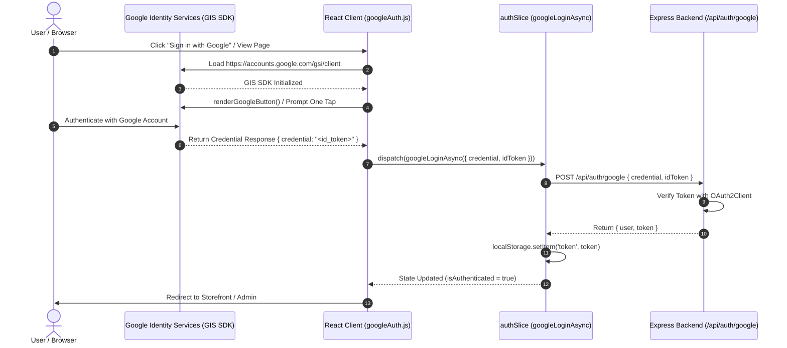

# NexaCart AI — Frontend Application

[](https://react.dev/)
[](https://vitejs.dev/)
[](https://tailwindcss.com/)
[](https://redux-toolkit.js.org/)
[](https://reactrouter.com/)
[](https://razorpay.com/)

The **NexaCart AI Frontend** is a modern Single Page Application (SPA) built with React 19, Vite, Tailwind CSS, and Redux Toolkit. It provides an intuitive storefront interface, real-time AI shopping assistance, automated budget planning, Razorpay payments, interactive order fulfillment tracking, and a comprehensive Shopify-style administrative operational hub.

---

## Table of Contents

- [Features & Capabilities](#features--capabilities)
- [Technology Stack](#technology-stack)
- [Directory Structure](#directory-structure)
- [Application Routing](#application-routing)
- [State Management (Redux Toolkit)](#state-management-redux-toolkit)
- [Backend Communication & API Service](#backend-communication--api-service)
- [Authentication & Google Sign-In Flow](#authentication--google-sign-in-flow)
- [Payment Checkout Flow (Razorpay)](#payment-checkout-flow-razorpay)
- [AI-Driven User Interfaces](#ai-driven-user-interfaces)
- [Administrative Control Center](#administrative-control-center)
- [Environment Configuration](#environment-configuration)
- [Available Package Scripts](#available-package-scripts)
- [Local Development Setup](#local-development-setup)
- [Production Build & Vercel Deployment](#production-build--vercel-deployment)
- [Troubleshooting & FAQs](#troubleshooting--faqs)
- [Navigation Links](#navigation-links)

---

## Features & Capabilities

### Customer Experience
- **Responsive Multi-Category Storefront**: Curated catalog showcasing Mobiles, Laptops, Electronics, Gaming, Groceries, Fashion, Furniture, Home & Office, Kitchen, and Books.
- **Faceted Product Search & Filtering**: Instant client-side and server-side filtering by category, search text, and dynamic price sliders.
- **Rich Product Detail Pages**: High-resolution multi-angle image galleries, technical specification breakdown, stock status, ratings, and customer reviews.
- **Shopping Cart & Wishlist**: Real-time synchronization with MongoDB, guest-to-user cart persistence, quantity adjusters, and direct checkout transfers.
- **Dual Checkout Options**: Seamless integration with the Razorpay standard payment modal (UPI, cards, net banking) and Cash on Delivery (COD).
- **Interactive Order Tracking & History**: Visual order status timeline, delivery partner identification (Delhivery, Blue Dart, DTDC), tracking numbers, and one-click return or cancellation requests.
- **Downloadable Tax Invoices**: Dynamic HTML/CSS invoice generation with QR verification codes via [`src/utils/generateInvoice.js`](src/utils/generateInvoice.js).

### Generative & Conversational AI
- **Floating AI Shopping Copilot (`AIChatBox`)**: Always-accessible conversational assistant with contextual quick-prompt chips, intent classification, and instant product card recommendations.
- **Smart Budget Assistant**: Dedicated financial shopping copilot that optimizes product bundles within defined budget limits, calculates instant discounts, and checks free shipping eligibility.
- **Smart Recommendations Hub**: Personalized product suggestions based on customer wishlist and cart category profiles.
- **Smart Shopping Hub (`SmartShoppingHub`)**: Interactive AI Discovery, product specification comparison (`AICompare`), and proactive shopping planning (`ShoppingPlanner`).

---

## Technology Stack

All libraries and frameworks listed below are actively configured in [`frontend/package.json`](package.json):

| Category | Technology | Version | Purpose |
| :--- | :--- | :--- | :--- |
| **Core Framework** | React | `^19.2.6` | Component-based UI architecture. |
| **Build Tooling** | Vite | `^8.0.12` | Lightning-fast HMR and optimized production bundling. |
| **Routing** | React Router DOM | `^7.15.1` | Declarative client-side routing, protected routes, and layouts. |
| **State Management** | Redux Toolkit & React-Redux | `^2.11.2` / `^9.2.0` | Global state slices for authentication, catalog, cart, wishlist, and orders. |
| **Styling & Design** | Tailwind CSS & PostCSS | `^3.4.19` / `^8.5.14` | Utility-first responsive design system with custom CSS variables. |
| **Animation** | Framer Motion | `^12.38.0` | Smooth UI transitions, modal animations, and chat widget toggles. |
| **Icons & Visuals** | Lucide React & React Icons | `^1.16.0` / `^5.6.0` | Clean, modern SVG icon library. |
| **Data Visualization** | Recharts | `^3.8.1` | Admin analytics charts (revenue trends, category distribution). |
| **HTTP Client** | Axios | `^1.16.1` | Promise-based HTTP client with request/response interceptors. |
| **Notifications** | React Hot Toast | `^2.6.0` | Modern toast alerts for cart updates, errors, and checkout feedback. |
| **Authentication** | Google Identity Services (GIS) | Script CDN | Google OAuth 2.0 credential and ID token sign-in. |
| **Payments** | Razorpay Checkout SDK | Script CDN | Official Razorpay modal payment checkout (`checkout.js`). |
| **Validation & Forms** | React Hook Form & Zod | `^7.75.0` / `^4.4.3` | Form handling and validation resolvers. |
| **Utilities** | clsx, tailwind-merge, qrcode | Various | Dynamic class merging and invoice QR code generation. |

---

## Directory Structure

```text
frontend/
├── public/                    # Static public assets (favicons, manifest)
├── src/
│   ├── admin/                 # Internal admin utilities and helpers
│   ├── ai/                    # Client-side AI reasoning & conversation engines
│   │   ├── budgetEngine.js        # Algorithmic budget knapsack optimizer and savings calculator
│   │   ├── conversationEngine.js  # Conversational state manager, memory bounds, & response synthesis
│   │   └── intentClassifier.js    # Regex & keyword intent classifier with typo correction
│   ├── assets/                # Local images, SVG illustrations, and icons
│   ├── components/            # Reusable UI component modules
│   │   ├── AIChat/                # AIChatBox, ChatHeader, ChatInput, ChatMessage, FloatingChat
│   │   ├── Orders/                # Order status badges, timeline trackers, and cancellation modals
│   │   ├── SmartShoppingHub/      # AICompare, AIDiscovery, and ShoppingPlanner
│   │   ├── ui/                    # Base design system primitives (buttons, inputs, cards)
│   │   ├── AdminErrorBoundary.jsx # Isolated error boundary for administrative modules
│   │   ├── AdminSidebar.jsx       # Operational admin sidebar navigation with telemetry status
│   │   ├── Footer.jsx             # Global storefront footer
│   │   ├── Navbar.jsx             # Storefront header with category navigation and live search
│   │   └── ProtectedRoute.jsx     # Route guard enforcing authentication and role authorization
│   ├── hooks/                 # Custom React hooks (window resize, debounce, local storage)
│   ├── layouts/               # Layout wrappers
│   │   ├── AdminLayout.jsx        # Admin panel shell with sidebar and breadcrumbs
│   │   └── MainLayout.jsx         # Storefront shell with Navbar, Footer, and FloatingChat
│   ├── pages/                 # Route page components
│   │   ├── admin/                 # Operational Admin Suite (20 specialized modules)
│   │   │   ├── Dashboard.jsx          # Executive KPI overview with Recharts analytics
│   │   │   ├── Orders.jsx             # Admin order processing, status updates, & courier assignment
│   │   │   ├── PaymentManagement.jsx  # Razorpay audit ledger and manual payment verification
│   │   │   ├── Products.jsx           # Catalog inventory manager & stock replenishment
│   │   │   ├── Inventory.jsx          # Stock health gauges & reorder alerts
│   │   │   ├── Categories.jsx         # Category taxonomy manager
│   │   │   ├── Users.jsx              # Customer directory and access roles
│   │   │   ├── MissingRequests.jsx    # Unfulfilled search demand tracking
│   │   │   ├── CustomerQueries.jsx    # Customer support inquiry tracker
│   │   │   ├── SmartCoupons.jsx       # Coupon creation and discount engine
│   │   │   ├── ExportReports.jsx      # CSV report export center
│   │   │   ├── AdminSettings.jsx      # System operational preferences
│   │   │   └── AdminProfile.jsx       # Admin security credentials management
│   │   ├── user/                  # Customer dashboard views
│   │   │   └── Dashboard.jsx          # User overview (recent orders, spending, saved addresses)
│   │   ├── AiRecommendations.jsx  # Personalized AI recommendation page
│   │   ├── BudgetAssistant.jsx    # Interactive AI budget planner page
│   │   ├── Cart.jsx               # Shopping cart with price breakdown and coupon entry
│   │   ├── Checkout.jsx           # Multi-step checkout with Razorpay modal & COD
│   │   ├── Home.jsx               # Landing page with hero banner, categories, & featured items
│   │   ├── Login.jsx              # Customer login with email/password and Google One Tap
│   │   ├── OrderDetail.jsx        # Detailed tracking timeline, courier link, & invoice download
│   │   ├── Orders.jsx             # Customer order history list
│   │   ├── OrderSuccess.jsx       # Post-checkout confirmation view
│   │   ├── PaymentSuccess.jsx     # Razorpay payment verification confirmation view
│   │   ├── ProductDetail.jsx      # Single product page with gallery and stock indicators
│   │   ├── Products.jsx           # Full catalog grid with faceted sidebar filters
│   │   ├── Profile.jsx            # User account settings, phone number, and address
│   │   ├── Register.jsx           # Account creation with validation and Google sign-up
│   │   ├── Search.jsx             # Dedicated search results view
│   │   └── Wishlist.jsx           # Saved products list with quick add-to-cart
│   ├── redux/                 # Redux Toolkit global state store
│   │   ├── slices/                # State slices (authSlice, cartSlice, productsSlice, etc.)
│   │   └── store.js               # Redux store configuration
│   ├── services/              # API abstraction layer
│   │   └── api.js                 # Axios instance with dynamic base URL and JWT interceptor
│   ├── utils/                 # Utility functions
│   │   ├── generateInvoice.js     # Printable HTML invoice generator with QR code
│   │   ├── googleAuth.js          # Google Identity Services (GIS) SDK loader and button renderer
│   │   └── imageHelper.js         # Image fallback resolution helper
│   ├── App.jsx                # Top-level route switchboard and session initialization
│   ├── index.css              # Global styles, Tailwind directives, and CSS theme tokens
│   └── main.jsx               # React DOM entry point wrapping Redux Provider and Router
├── .env                       # Local environment variables (do not commit to Git)
├── .env.production            # Production environment variables for Vite builds
├── eslint.config.js           # ESLint 9 configuration with React Hooks and Refresh plugins
├── index.html                 # HTML shell with Google fonts and Razorpay script containers
├── package.json               # Frontend dependencies and scripts
├── tailwind.config.js         # Tailwind CSS design system tokens and color definitions
└── vite.config.js             # Vite configuration with path aliases and dev server proxy
```

---

## Application Routing

All application routes are defined in [`src/App.jsx`](src/App.jsx) and wrapped in React `Suspense` for code splitting.

### Public Routes
- `/login`: User login page with credentials form and Google One Tap.
- `/register`: User account creation form with Google Sign-Up button.

### Protected Customer Routes (`ProtectedRoute adminOnly={false}`)
Wrapped inside `MainLayout` (including global `Navbar`, `Footer`, and `FloatingChat`):
- `/`: Home landing page with category carousel and trending products.
- `/products`: Catalog browsing with sidebar filter controls.
- `/products/:id`: Product detail view with multi-image gallery.
- `/search`: Dedicated search page.
- `/cart`: Active shopping cart with item controls.
- `/wishlist`: Saved products list.
- `/checkout`: Multi-step checkout with address form and Razorpay modal.
- `/payment-success`: Payment verified status page with order ID.
- `/order-success/:orderId`: COD order placed confirmation page.
- `/orders`: Customer order history list.
- `/order/:id`: Order details, tracking status timeline, and invoice generation.
- `/profile`: User account details and address editor.
- `/budget-assistant`: Interactive AI budget optimizer page.
- `/ai-recommendations`: Personalized product recommendations.
- `/user/dashboard`: Customer account dashboard.

### Protected Admin Routes (`ProtectedRoute adminOnly={true}`)
Wrapped inside `AdminErrorBoundary` and `AdminLayout` (including `AdminSidebar`):
- `/admin`: Executive dashboard with sales charts and telemetry.
- `/admin/orders`: Order processing and courier tracking assignment.
- `/admin/payments`: Razorpay transaction records and payment audits.
- `/admin/products`: Product catalog editor and stock status manager.
- `/admin/categories`: Category taxonomy manager.
- `/admin/inventory`: Stock inventory monitor with reorder alerts.
- `/admin/missing-requests`: Unfulfilled customer search demand logs.
- `/admin/users`: Customer management and role assignments.
- `/admin/customer-queries`: Customer support ticket management.
- `/admin/smart-coupons`: Promotional coupon manager.
- `/admin/reports`: Downloadable CSV sales and fulfillment reports.
- `/admin/settings`: Administrative preferences.
- `/admin/profile`: Admin account settings.

### Route Protection Logic (`ProtectedRoute.jsx`)
1. If the user session token is missing, the user is redirected to `/login`.
2. While the profile is validating (`token` exists but `user` object is loading), a loader is displayed.
3. If a regular user navigates to an admin route (`adminOnly={true}`), they are redirected to `/user/dashboard`.
4. If an authenticated administrator visits customer routes, they are redirected to `/admin`.

---

## State Management (Redux Toolkit)

The global store is configured in [`src/redux/store.js`](src/redux/store.js) using Redux Toolkit:

```text
store
├── auth       # Token, user profile, role, session status, login/register thunks
├── products   # Catalog items, active category, price filters, loading state
├── cart       # Cart items array, total item count, cart calculation thunks
├── wishlist   # Wishlist items array and toggle thunks
└── orders     # Customer orders list, active order detail, cancel/return thunks
```

### Key Redux Slices

#### 1. `authSlice.js`
- **Thunks**: `loginUserAsync`, `registerUserAsync`, `googleLoginAsync`, `fetchUserProfile`, `updateUserProfileAsync`.
- Automatically persists and removes tokens in `localStorage.getItem('token')`.
- On application boot ([`App.jsx`](src/App.jsx#L60-L65)), if a token exists, `fetchUserProfile()` runs to validate the session.

#### 2. `cartSlice.js`
- **Thunks**: `fetchCart`, `addToCart`, `updateCartItemQuantity`, `removeFromCart`, `clearCart`.
- Triggered automatically whenever a user authenticates ([`App.jsx`](src/App.jsx#L67-L73)).

#### 3. `wishlistSlice.js`
- **Thunks**: `fetchWishlist`, `addToWishlist`, `removeFromWishlist`.
- Persists user preferences and synchronizes with the AI recommendation engine.

#### 4. `ordersSlice.js`
- **Thunks**: `createOrder`, `fetchMyOrders`, `fetchOrderById`, `cancelOrder`, `requestReturn`.

#### 5. `productsSlice.js`
- **Thunks**: `fetchProducts`, `fetchProductById`.
- Handles search keywords, category filtering, and price range constraints.

---

## Backend Communication & API Service

Frontend HTTP communication is centralized in [`src/services/api.js`](src/services/api.js) via a customized Axios instance.

### Base URL Resolution
The API base URL is resolved dynamically:
```javascript
const getBaseURL = () => {
  const envUrl = import.meta.env.VITE_API_URL;
  if (!envUrl) {
    return 'http://localhost:5000/api';
  }
  const sanitizedUrl = envUrl.replace(/\/$/, '');
  if (!sanitizedUrl.endsWith('/api')) {
    return `${sanitizedUrl}/api`;
  }
  return sanitizedUrl;
};
```
- During local development, it defaults to `http://localhost:5000/api`.
- In production, it reads `VITE_API_URL` from `.env.production` (e.g., `https://nexacart-backend-124q.onrender.com/api`).
- Trailing slashes are stripped, and `/api` is appended if missing.

### Request Interceptor
The request interceptor automatically:
1. Strips redundant `/api` or `api/` prefixes from endpoints (e.g., calling `api.get('/api/products')` becomes `/products` against `baseURL`).
2. Reads the JWT from `localStorage.getItem('token')`.
3. Attaches the header: `Authorization: Bearer <token>`.

### Development Proxy
In [`vite.config.js`](vite.config.js#L13-L20), a development proxy routes `/api` requests:
```javascript
server: {
  proxy: {
    '/api': {
      target: 'http://localhost:5000',
      changeOrigin: true,
    },
  },
}
```

---

## Authentication & Google Sign-In Flow

NexaCart AI supports both traditional email/password credentials and Google Identity Services (GIS).



### Google Identity Services Implementation
- **Helper Module**: [`src/utils/googleAuth.js`](src/utils/googleAuth.js).
- **Client ID Resolution**: Reads `import.meta.env.VITE_GOOGLE_CLIENT_ID`.
- **Initialization**: `initGoogleIdService(handleSuccessCallback)` dynamically loads `https://accounts.google.com/gsi/client` and configures `window.google.accounts.id.initialize`.
- **Button Rendering**: `renderGoogleButton(containerRef, options)` renders the official personalized Google Sign-In button on [`Login.jsx`](src/pages/Login.jsx) and [`Register.jsx`](src/pages/Register.jsx).

---

## Payment Checkout Flow (Razorpay)

Payment handling in [`src/pages/Checkout.jsx`](src/pages/Checkout.jsx) supports **Razorpay Standard Checkout** and **Cash on Delivery**.

### Razorpay Checkout Sequence
1. **Dynamic Script Injection**: Loads `https://checkout.razorpay.com/v1/checkout.js` on demand via `loadRazorpayScript()`.
2. **Order Initialization**: Dispatches `POST /api/payment/create-order` with the calculated order total.
3. **Modal Display**: Launches `new window.Razorpay(options)` configured with the order ID, company branding (`#059669` emerald green), and prefilled user contact details.
4. **Signature Verification**: Upon payment completion, Razorpay triggers the `handler` callback with `{ razorpay_order_id, razorpay_payment_id, razorpay_signature }`.
5. **Backend Confirmation**: Sends verification payload to `POST /api/payment/verify`.
6. **Order Finalization**: Upon verification, the cart is cleared (`dispatch(clearCart())`), and the user is navigated to [`PaymentSuccess.jsx`](src/pages/PaymentSuccess.jsx).

---

## AI-Driven User Interfaces

### 1. Persistent Floating Chat (`AIChatBox.jsx`)
Available across all customer pages via `MainLayout`:
- Managed by [`src/ai/conversationEngine.js`](src/ai/conversationEngine.js) and [`src/ai/intentClassifier.js`](src/ai/intentClassifier.js).
- Analyzes natural language prompts, extracts numeric price ranges (e.g., *"under 25000"*, *"between 500 and 1000"*), technical specifications (RAM, AMOLED, storage), and filters catalog products.
- Provides contextual follow-up query chips (e.g., *"Compare these phones"*, *"Filter under ₹20,000"*).
- Includes prompt suggestion chips on first open.

### 2. Smart Budget Assistant (`BudgetAssistant.jsx`)
- Located at `/budget-assistant`.
- Users specify a budget limit and category.
- Evaluates catalog products, builds an optimal bundle fitting within the budget, calculates discount savings vs. original prices, and checks free shipping qualification (₹1,500 threshold).

### 3. Smart Shopping Hub (`SmartShoppingHub/`)
- **AI Discovery (`AIDiscovery.jsx`)**: Intelligent exploration of top deals and category highlights.
- **Specification Comparison (`AICompare.jsx`)**: Side-by-side technical specification matrix.
- **Shopping Planner (`ShoppingPlanner.jsx`)**: Multi-item goal-based planning.

---

## Administrative Control Center

The admin panel at `/admin` provides operational control for store managers:

- **Dashboard (`Dashboard.jsx`)**: Real-time revenue statistics, sales charts, average order values, and inventory alerts.
- **Order Management (`Orders.jsx`)**: Complete order lifecycle manager. Allows admins to transition orders from `Confirmed` through `Delivered`, assign couriers (Delhivery, Blue Dart, DTDC), and assign tracking numbers.
- **Payment Ledger (`PaymentManagement.jsx`)**: Real-time view of Razorpay transaction logs, payment IDs, order IDs, and manual audit verification tools.
- **Product Management (`Products.jsx`)**: Catalog management with live stock adjustments, pricing controls, and image gallery validation.
- **Inventory Monitor (`Inventory.jsx`)**: Stock level health gauges with low-stock warnings.
- **Demand Intelligence (`MissingRequests.jsx`)**: Analyzes customer searches that yielded 0 catalog results to guide inventory purchasing.
- **Export Center (`ExportReports.jsx`)**: Generates downloadable CSV exports for accounting and order logs.

---

## Environment Configuration

Configure environment variables in `frontend/.env` (local) and `frontend/.env.production` (production).

### Supported Environment Variables

| Variable | Required | Default / Example | Purpose |
| :--- | :---: | :--- | :--- |
| `VITE_API_URL` | **Yes** | `http://localhost:5000/api` | Base URL of the backend REST API. Sanitized automatically by [`api.js`](src/services/api.js). |
| `VITE_GOOGLE_CLIENT_ID` | **Yes** | `34569...apps.googleusercontent.com` | Google Cloud OAuth 2.0 Web Client ID used by Google Identity Services SDK. |
| `VITE_RAZORPAY_KEY_ID` | No | `rzp_test_...` | Optional fallback Razorpay Key ID if not returned dynamically by the backend order creation endpoint. |

> [!CAUTION]
> Vite embeds variables prefixed with `VITE_` directly into the compiled client-side JavaScript bundle. **Never put backend secrets, private keys, or database credentials in frontend environment files.**

---

## Available Package Scripts

Defined in [`frontend/package.json`](package.json):

| Script | Command | Purpose |
| :--- | :--- | :--- |
| `npm run dev` | `vite` | Starts the Vite development server with Hot Module Replacement (HMR). Default: `http://localhost:5173`. |
| `npm run build` | `vite build` | Compiles and tree-shakes the application into optimized static assets in `frontend/dist/`. |
| `npm run lint` | `eslint .` | Runs ESLint across the codebase using ESLint 9 configuration. |
| `npm run preview` | `vite preview` | Locally serves the production build from `dist/` for pre-deployment verification. |

---

## Local Development Setup

1. **Navigate to the frontend directory**:
   ```bash
   cd frontend
   ```

2. **Install dependencies**:
   ```bash
   npm install
   ```

3. **Configure local environment variables**:
   Create a `.env` file in `frontend/`:
   ```ini
   VITE_API_URL=http://localhost:5000/api
   VITE_GOOGLE_CLIENT_ID=your_google_client_id.apps.googleusercontent.com
   ```

4. **Start the local development server**:
   ```bash
   npm run dev
   ```
   Open your browser to `http://localhost:5173`.

---

## Production Build & Vercel Deployment

The frontend is deployed to [Vercel](https://vercel.com/) as a Single Page Application.

### Building for Production
```bash
npm run build
```
Vite outputs the optimized static bundle to `frontend/dist/`.

### Vercel Deployment Configuration
- **Framework Preset**: `Vite`
- **Root Directory**: `frontend`
- **Build Command**: `npm run build`
- **Output Directory**: `dist`
- **Environment Variables**:
  - `VITE_API_URL`: `https://nexacart-backend-124q.onrender.com/api` (or your Render backend URL)
  - `VITE_GOOGLE_CLIENT_ID`: Your Google OAuth 2.0 Client ID

### SPA Routing on Vercel
Because the frontend uses React Router DOM with HTML5 history mode (`browserHistory`), client-side routes (like `/products`, `/admin/orders`) require Vercel to route all requests back to `index.html`. This is handled automatically by the Vite framework preset or via standard rewrite rules.

---

## Troubleshooting & FAQs

### 1. `Network Error` or Failed API Requests
- **Symptom**: Axios requests fail with `ERR_CONNECTION_REFUSED` or `Network Error`.
- **Cause**: Backend server is not running or `VITE_API_URL` is pointing to an incorrect host/port.
- **Fix**: Ensure the backend is active at `http://localhost:5000` (or your configured Render URL). Check `VITE_API_URL` in `.env` and restart the Vite development server.

### 2. CORS Blocked on Cross-Origin Requests
- **Symptom**: Browser console logs `Access to XMLHttpRequest has been blocked by CORS policy`.
- **Cause**: Frontend origin (e.g. `http://localhost:5173` or custom domain) is not permitted in the backend's `allowedOrigins`.
- **Fix**: Verify backend `CLIENT_URL` includes your domain. Note that `server.js` automatically permits all `localhost:*` ports and `https://nexacart-*.vercel.app` domains.

### 3. Google Sign-In Button Does Not Render
- **Symptom**: Google button container is blank or GIS prompts `[GSI_LOGGER]: The given client ID is not valid`.
- **Cause**: `VITE_GOOGLE_CLIENT_ID` is missing, misconfigured, or the current origin is not listed under **Authorized JavaScript origins** in Google Cloud Console.
- **Fix**: Open Google Cloud Console → **APIs & Services** → **Credentials** → Edit OAuth 2.0 Client ID → Add `http://localhost:5173` and `https://nexacart-ai.vercel.app` to **Authorized JavaScript origins**.

### 4. Razorpay Modal Fails to Open
- **Symptom**: Toast error: `Failed to load Razorpay SDK`.
- **Cause**: Client network blocked `https://checkout.razorpay.com/v1/checkout.js` (e.g., ad-blocker or offline).
- **Fix**: Disable aggressive browser ad-blockers for checkout domains, verify internet access, and confirm the backend returns a valid `order_id`.

---

## Navigation Links

- **Root Documentation**: [README.md](../README.md)
- **Backend Documentation**: [backend/README.md](../backend/README.md)
- **System Architecture**: [ARCHITECTURE.md](../ARCHITECTURE.md)
